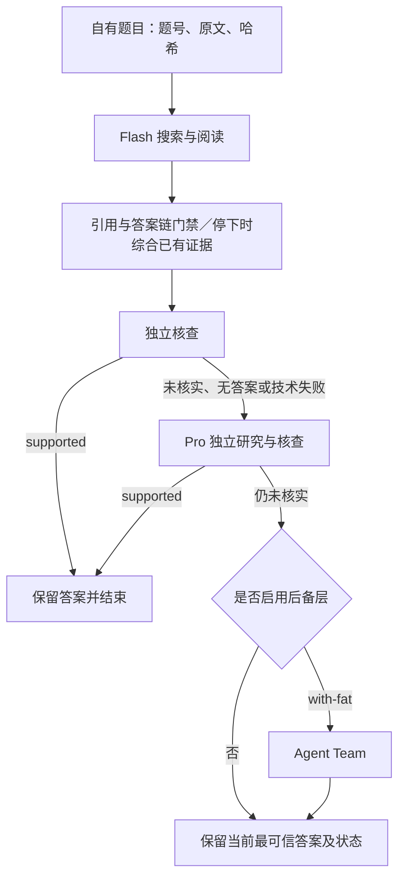

# Tiered Deep Research Agent

A tiered research agent for multi-step information retrieval and evidence synthesis, with evidence-based escalation, independent answer checks, bounded spending, and optional multi-agent collaboration. This repository contains source code and configuration, not benchmark questions, reference answers, or run artifacts. Reported results are scoped to the specific evaluations described below.

## 项目简介

本项目是一套面向复杂信息检索与多来源证据关联的分层研究智能体系统。项目围绕“如何根据研究进展分配计算资源、如何核查答案依据、如何让多智能体及时收敛”三个问题，对研究流程进行了程序化设计与实现。

系统采用轻量研究、深度研究与可选团队协作的分层执行方式，根据证据状态和独立核查结果决定是否升级研究。开发重点包括分层路由、证据校验、答案选择、按需任务委派、研究停止与回收、费用记录及来源防泄露，并通过离线回归、真实题目运行和失败轨迹分析持续验证。

项目将升级、委派准入、停止与答案替换等关键决策落实到运行代码中，目标是减少重复搜索、无效任务扩张以及证据不足时过早结束的问题。模型仍负责研究与语义判断，程序检查和核查状态的适用范围见下文。

这里的“分层”由本次运行的证据状态决定，不预先按题号分配模型：先用 DeepSeek Flash 研究，未核实的答案再交给 DeepSeek Pro 独立研究；Agent Team 是显式启用的可选后备层。搜索使用 Serper，读页使用 Jina，沙箱使用 E2B。

两个版本标签分别保留开发结果对应代码与后续实现：

- `v2.3.2-dev30`：下文 DEV30 主结果对应的 V2.3.2 代码。
- `v2.6.1-guard-v8`：V2.6.1 与防泄露守卫 v8；不能用它的名称重新标注 V2.3.2 的历史成绩。

## 本项目的主要开发工作

- **分层研究与模型路由。** 设计 Flash → Pro 的执行路径，接入可选 Agent Team 后备层；根据核查状态决定是否升级。Flash 与 Pro 的研究上下文隔离，Pro 不接收 Flash 的候选答案。实现见 [分层路由器](local_runner/tiered_router.py)。
- **证据门禁与独立核查。** 将引文真实性、题目条件覆盖和语义支持分开处理：程序核对引用是否来自本次有效来源，独立核查进一步判断材料能否支持答案，同时保留未证实条件和冲突记录。实现见 [研究控制](workflows/agent_team/progressive.py) 与 [答案核查](workflows/agent_team/answer_settlement.py)。
- **答案选择与停止逻辑。** 根据不同阶段的核查状态选择答案，同级结果保留较早答案；研究停止时对已有材料进行有界综合，记录答案状态和未解决问题，避免将空结果标为已完成。具体规则见 [分层研究说明](local_profiles/TIERED_RESEARCH_V2.md)。
- **按需多智能体调度。** 改进团队委派流程，在显式启用的按需研究配置下，先声明具体事实缺口，再安排子任务；加入结构校验、依赖环检查、范围去重和并发入队控制。实现与边界见 [progressive_research_v1](local_profiles/PROGRESSIVE_RESEARCH_V1.md)。
- **研究收敛与资源回收。** 实现 `review_research` 协议，记录研究进展、证据收据和剩余缺口；结束研究时冻结新研究工作，并衔接已有的取消与回收路径。实现见 [收敛控制](workflows/agent_team/convergence.py) 与 [清理流程](workflows/agent_team/convergence_cleanup.py)。
- **预算、诊断与可追溯记录。** 在本地运行适配器中接入费用账本、运行期限和来源记录，保留工具调用与停止原因，使预算停止、技术故障和证据缺口能够分别分析。实现见 [预算适配器](local_runner/budget_adapter.py)、[运行入口](local_runner/run_native.py) 与 [任务监督](local_runner/task_supervisor.py)。
- **评测口径与泄露审计。** 将冻结判分、名称形式裁定和来源泄露审计分开记录，保留历史判分及争议；结合回放、反例和真实运行对照检查改动效果。运行时加入 [来源防泄露守卫](local_runner/answer_label_guard.py)，审计方法、历史结果和证据范围见下文；原始评测记录不随仓库分发。

## 架构



Flash 与 Pro 的研究上下文隔离，Pro 不接收 Flash 的候选答案。后层结果只有可信度更高才替换先前答案，同级保留较早答案。优先级为：独立核查通过，其次通过门禁或团队给出的答案，再其次强制综合或未核查答案。没有答案时保留明确状态，不把空结果补成“已完成”。这些等级是检查状态，不是正确性的保证。

源码还提供 `--with-graph` 实验后备层，与 `--with-fat` 互斥，默认均关闭。它不属于下文 DEV30 主结果；它的上下文与核验策略也不能套用为 Flash、Pro 的行为说明。

## 核心设计

### 证据门禁与语义核查分工

答案提交时检查引文是否存在于本次有效来源，并核对所问部分与条件的文字追溯覆盖。V2 配置采用所问部分 80%、整题条件 50% 的答案链门禁；它们是试验阈值，计算的是文本覆盖，不代表已经证明相应比例的事实。独立核查另行查看题目、答案和引用原文，判断证据是否支持答案。

研究因预算或其他停止条件结束时，程序从保存的证据中进行一次有界综合；无法支持具体答案时仍保留缺口。引用校验通过不能替代语义判断，独立核查自身也可能判错。

### 按需委派与收敛

`progressive_research_v1` 让主智能体先搜索、读页，再通过 `review_research` 声明需要帮助的具体事实缺口。任务含对象、要求、来源收据和依赖。程序校验结构及引用、检测依赖环，并在覆盖整个入队过程的锁内按活动任务范围去重。

在这个显式配置下，单缺口最多一个助手，至少两个独立未解决缺口才允许最多两个运行或排队中的助手；这不是全项目所有模式的统一并发上限。助手不能递归委派。程序无法保证识别所有语义相同但措辞不同的任务。

最终收敛通过 `review_research(action="finalize")` 冻结新的研究工作，走现有取消与回收路径，并返回答案。待处理的子任务报告与已经声明的实质冲突仍须处理；收到收据只表示收到工具结果，不表示该结果真实。

### 费用与诊断

本地适配器保存来源、引用位置、工具收据、传输阶段和费用账本。模型费用、未知用量的保留金额与外部服务计量应分开理解。每题上限、批次上限、余额底线和错误停止条件共同控制后续工作；批次停止主要阻止新运行启动，已启动运行可能继续收尾。

### 防泄露守卫

v8 在搜索、读页、摘要输入和部分其他工具路径上拦截已知评测来源、题目复述及答案标签信号，并保留拦截记录。它不读取参考答案来路由题目。“未命中这些规则”只说明没有检出所定义信号，不证明运行绝对独立；正常网页也可能被误拦。

实现说明见 [分层规则](local_profiles/TIERED_RESEARCH_V2.md)、[按需委派](local_profiles/PROGRESSIVE_RESEARCH_V1.md) 和 [本地运行适配器](local_runner/README.md)。其中对历史 `outputs/` 文件的引用是开发记录索引，这些运行文件不随仓库发布。

## 结果

### DEV30：归档中的开发对照

DEV30 是 BrowseComp 的 30 题开发子集。使用冻结模板的 LLM 判分器，每题一次、不重试；另对名称写法做裁定。以下来自发布材料列明的历史结果，不是本次发布过程中重新跑出的成绩。

| 配置 | 冻结判分 | 名称写法裁定后 | 无答案题 |
|---|---:|---:|---:|
| 基线：DeepSeek Pro + Serper，单次运行 | 21/30 | 22/30 | 3 |
| 分层 V2.3.2：Flash → Pro | 25/30 | 26/30 | 0 |

与基线比较，改进版多答对 7 题，同时丢失 3 题，净增加 4 题。30 题中 21 题通过独立核查，其中 19 题正确，约 90%；Flash 层核查通过的 16 题均正确，约一半的题在 Flash 层核实结束。独立核查通过与最终判对不是同一件事。

第一版分层系统加上 Pro 后仍有 7 题无答案。改用上述答案链门禁，并在研究停止时综合已有证据后，无答案题降至 0。无答案减少不能单独证明正确率提升。

### 另选 200 题：作者报告的补充验证

项目作者确认：从题集中排除前述 DEV30 后，另选同一组 200 题，基线与改进版都实际运行，并使用相同判分标准。以下结果由作者提供，并按本次简历修订补充统计口径；与上文 DEV30 分开列示。

| 配置 | 名称等价写法裁定后 | 比例 |
|---|---:|---:|
| 基线 | 147/200 | 73.5% |
| 改进版 | 174/200 | 87.0% |

两者相差 13.5 个百分点。裁定接受指向同一实际对象的缩写、昵称、头衔、全名等表达差异；仅与该对象有关联，或实际指向另一个对象，不算等价。这些是裁定后的成绩，不是固定模板 LLM 评委单次判分直接输出的原始计数。

| 200 题补充指标 | 作者报告值 | 对比或分母说明 |
|---|---:|---|
| Flash 核实结束的题目 | 143/200，71.5% | 分母为这组 200 题 |
| 核查通过的答案中判对的数量 | 127/143，约 88.8% | 分母为作者报告的核查通过答案数；核查通过不保证正确 |
| 无答案题：基线 → 改进版 | 20 → 0 | 对比基线，不是下行的第一版分层系统 |
| 无答案题：第一版分层系统 → 改进版 | 46 → 0 | 对比第一版分层系统；不与上行合并统计 |
| Flash 单次运行成本相对 Pro | 约为 1/3 | 作者报告的单次运行成本对比，不表示整题成本降低至 1/3 |
| 改进版单题实际成本 | 约 ¥1.9 | 作者提供的这组评测汇总；本次未独立核算其账单 |

这组数字由项目作者提供并确认。当前发布材料没有完整的 200 题逐题记录与账单，本次文档核对没有独立重算；也没有将其绑定到某个尚未核实的代码标签、模型配置或防泄露版本。127/143 与 143/200 的分母含义不同，不据此推定所有核查通过答案都来自同一层，也不从这些汇总反推出各层逐题分布。

200 题与 DEV30 不合并总分。上表费用与无答案数量是作者对 200 题补充提供的汇总，不是将 DEV30 的金额或计数乘比例得到；下文 DEV30 的成本表和历史账本口径仍独立保留。DEV30 的泄露审计结论不能迁移到这 200 题上。排除 DEV30 本身也不证明这组题在全部开发过程中从未被使用。

### Agent Team：单独的小样本对照

在 DeepSeek Flash 上，原版 Agent Team 与 convergence v1 各运行 7 次，覆盖 5 道不同题目：

| 指标 | 原版 Agent Team | convergence v1 |
|---|---:|---:|
| 完成任务 | 3/7，约 43% | 7/7，100% |
| 技术失败 | 4 | 0 |
| 判对 | 1/7，约 14% | 5/7，约 71% |

最难的两道题上，每个正确答案的成本从 ¥31.5 降至 ¥7.5。同一道题、两者均答对的单次比较中，按需委派 progressive research v1 相比 convergence v1：模型调用 231 → 11，token 509 万 → 21 万，耗时 1,154 s（约 19 分钟）→ 103 s（约 1.7 分钟），成本 ¥2.26 → ¥0.18。

这组数据属于独立对照，不能计入 DEV30 成绩，也不能推广为全部题目的速度或成本收益。

## 成本

| 口径 | 金额 |
|---|---:|
| V2.3.2 DEV30 这一列实际花费 | 约 ¥56 |
| 每题平均 | 约 ¥1.9 |
| 按裁定后 26 题计算，每答对一题 | 约 ¥2.1 |
| 基线按发布材料所用价格重算 | 约 ¥12.7 |
| 基线每答对一题 | 约 ¥0.58 |

**分层版每答对一题的成本约为基线的 3.7 倍。** 基线金额是按发布材料价格重新估算，不是原始实付，也不是对当前服务价格的承诺。准确率对照和成本对照必须同时看。

Flash 每次运行的账本平均 ¥1.09，约为 Pro（¥3.08）的三分之一。账本为保守估算；历史运行仅在优惠时段进行时，实际花费约为账本的 55%，这一比例不能直接用于未来运行。每题硬上限、每批总额上限和余额底线仍须设置。Serper、Jina 与 E2B 的费用或额度不应当作模型费用混算。

## 局限

- 可从本次归档材料核对的主对照只有 DEV30 这 30 题，大多为单次运行；同题重复运行的结果会变化。200 题是另列的作者报告，缺少完整逐题记录供本次发布独立重算，不能弥补这个证据范围差异。
- 26/30 对应的分层列没有启用 Agent Team。团队的结果来自单独对照，不能合并宣传。
- 部分历史运行接触过评测相关来源，泄露审计为 `exposed` 或“无法判断”。例如 0007 没有一次运行被判为 `clean`；不能将全部成绩称为已排除泄露的独立作答成绩。
- 防泄露守卫 v8 在 V2.3.2 之后加入。V2.3.2 成绩并非在 v8 下测得；v8 的拦截也可能漏检或误拦。
- 冻结判分器每题只调用一次、不重试，模型判分可能不稳定。名称写法裁定另列，不能覆盖原始布尔值，也不能把裁定后结果冒充原判分。
- 引文存在、文本覆盖达标、独立检查返回 `supported` 均不能保证答案正确；后续层也可能引入错误。
- 门禁、任务调度及预算参数来自有限开发试验，不是普遍适用的难度阈值。服务时变、页面失效、验证页面和余额不足会影响结果。
- 为避免公开 BrowseComp 的题目和答案，仓库不包含题目原文、参考答案、答卷、运行轨迹或逐题判分结果。不能仅凭本仓库直接复现上述分数；可使用自己的题目验证行为。
- 发布包中的运行镜像引用属于原机器本地镜像，没有公开分发。运行者需要自行构建镜像，配置服务，并核对当前模型可用性和计价；历史价格核验窗口不会自动延长。

## 运行方式

### 环境与镜像

以下命令在仓库根目录执行。本地适配器面向 Windows PowerShell 与 Docker 的 Linux 容器；代码要求 Python 3.12 或更新版本。Docker 必须有足够资源运行镜像与临时工作区，本项目没有测定通用最低内存要求。外部访问是否需要代理取决于使用者网络，不能从历史机器的设置推导；不要将代理凭据写入仓库。

先使用仓库的 Dockerfile 构建自己的镜像。构建会下载基础镜像和依赖，不属于离线运行：

```powershell
docker build -t tiered-research-local:release .
```

`local_runner/launch.ps1` 模板目前引用原机器的本地镜像摘要，该镜像未公开。**在准备试跑目录之前**，将模板中 `dockerArgs` 的镜像项替换为自己构建的 `tiered-research-local:release`，或使用自己镜像的固定 ID。路由器也从此模板生成运行，当前没有 `--image` 参数。仅改某次已生成的脚本不会改变后续路由运行所用的镜像。

`prepare.py` 会把 `__PROJECT_ROOT__` 绑定为当前源码目录的父目录，并把源码挂载路径绑定为当前源码目录；`__DOCKER_EXE__` 会被替换为 `$DockerCommand`，生成脚本默认从 PATH 使用 `docker`，也可用 `-DockerCommand` 指定程序。不要直接执行含占位符的源模板。

### 环境变量与输入

变量名见 [runtime.env.template](local_runner/runtime.env.template)，模板值均为空。当前 launcher 的实际读取位置是：

```text
<仓库父目录>/outputs/frontier_agent_team_setup_20261027_01/secrets/runtime.env
```

这一位置不是仓库根目录的 `.env`，也不是试跑目录。可将空模板复制到该位置后，在本机编辑；不要提交实际的 `runtime.env`。

当前本地适配器要求 DeepSeek、Serper、Jina 和 E2B 的凭据。通过 DeepSeek 的 OpenAI 兼容接口运行时，`OPENAI_API_KEY` 与 `DEEPSEEK_API_KEY` 填同一把 DeepSeek 密钥；`OPENAI_MODEL` 使用适配器支持的 `deepseek-flash`，`OPENAI_BASE_URL` 为 `https://api.deepseek.com`，`OPENAI_PROVIDER` 为 `openai`，`SANDBOX_BACKEND` 为 `e2b`。这些是当前代码适配的配置，不能据此断言服务今后仍接受相同模型名。Pro 层由路由器显式覆盖模型；价格与模型兼容性须在实际付费运行前核对。

准备自己的问题文件，仅含 `id`、`question`、`question_sha256`。哈希为原始 `question` 字符串 UTF-8 字节的 SHA-256，不额外拼接换行；不要混入参考答案、判分或其他字段。题目文件与输出目录都应放在仓库外。

### 先离线测试单次适配器

下面只生成试跑目录并执行离线检查，不会研究题目：

```powershell
python local_runner/prepare.py --question-json ..\questions\my-question.json --out ..\runs\progressive-check --profile-file local_profiles/progressive_research_v1.yaml
powershell -ExecutionPolicy Bypass -File ..\runs\progressive-check\launch.ps1 -Mode test
```

输出目录必须是新的，且位于源码目录外。准备阶段保存当前源码指纹，不读取历史答卷，也不启动容器或服务调用。生成脚本的 `test` 模式使用 `--network none` 和离线占位值，不加载真实环境文件。源码修改后应重新准备目录，避免与记录的指纹不一致。

完整适配器测试依赖 Linux 容器中的 `/app` 源码路径，以下命令应在该容器内且依赖已安装时运行；`local_runner/test_*.py` 不在项目默认 pytest 收集目录内，需显式包含：

```bash
python -m pytest tests/test_tiered_router.py tests/test_tiered_research_v1.py tests/test_local_runner_progressive_v1.py local_runner -q
```

发布副本已排除上游自带的基准题库、答案和评测展示文件。`tests/test_frontier_search_bench.py` 与 `tests/test_benchmark_layout.py` 的部分检查依赖这些未分发的数据，不能在缺少数据时宣称全量测试通过。上游自动发布、定时任务和原全量 CI 已移至 `.github/disabled-workflows/`，不会自动运行；工作流内容保留供后续审阅。

测试结果需以本机实际输出为准。不要把命令示例或历史测试数字当作本次通过结果。

### 分层路由：预览与执行分开

路由器接受只含题目字段的 JSONL，或 `<id>/QUESTION.json` 子目录集合。先输入自己批准的批次账本上限：

```powershell
$batchBudgetCny = Read-Host '批次模型账本上限（人民币）'
python local_runner/tiered_router.py --questions ..\questions\own-questions.jsonl --out ..\runs\tiered-trial --max-total-cny $batchBudgetCny --workers 1 --dry-run
```

`--dry-run` 只校验输入并输出计划，不生成研究结果、不调用模型、不搜索或抓取。确认配置、实际费率与预算之后，去掉 `--dry-run` 才会启动付费研究。默认只有 Flash → Pro；如需团队后备层，显式加 `--with-fat`。`--with-graph` 是另一个实验后备层，不能与 `--with-fat` 同时使用。

单次适配器则通过生成脚本的 `-Mode execute` 开始付费运行；`-Mode cleanup` 可能调用 E2B 清理资源，也不是离线模式。搜索、读页、沙箱及模型分别可能消耗额度。不要把准备成功或离线测试通过视为联网服务可用性的证明。

路由器在相同输出目录下可继续已经记录的批次；已开始的试次不会任意重跑，异常中断的恢复有独立记录。停止原因、未知费用保留金额和已发生费用应保留，不能通过删除记录绕过预算。

## 目录结构

| 目录或文件 | 用途 |
|---|---|
| `frontier_agent/`、`apodex/` | 上游运行框架、模型和智能体基础能力 |
| `workflows/agent_team/` | 团队工作流、收敛与按需研究控制 |
| `plugins/` | 搜索、阅读、文件等工具 |
| `local_profiles/` | 分层、按需委派和实验配置及说明 |
| `local_runner/` | 准备、执行、路由、费用、守卫、清理与离线测试 |
| `tests/`、`apodex/tests/` | 开发回归测试 |
| `benchmarks/`、`tools/` | 评测接口和开发工具，不包含此次发布禁止的真实评测内容 |
| `docker/`、`Dockerfile` | 容器环境与入口 |
| `docs/UPSTREAM_README.md` | 保留的上游项目说明 |
| `MODIFICATIONS.md`、`NOTICE`、`LICENSE` | 改动清单、来源说明和许可证 |

## 致谢与许可证

基础智能体运行框架、部分工具及 Agent Team 工作流源自 [ApodexAI/FrontierAgent](https://github.com/ApodexAI/FrontierAgent)，对应的上游代码版本为 `e4cb2397109c957a2f99c3a5d850b9fc479dbef6`。本项目在此基础上设计和改进分层研究、证据核查与运行控制流程，具体修改见 [MODIFICATIONS.md](MODIFICATIONS.md)。项目采用 [Apache-2.0](LICENSE)，上游说明见 [docs/UPSTREAM_README.md](docs/UPSTREAM_README.md)，归属说明见 [NOTICE](NOTICE)。

FrontierAgent、Apodex 等名称仅用于说明来源，不作为本项目品牌，也不表示上游对本项目或评测结果背书。许可证不授予商标权。发布历史为满足不分发题目、答案、运行记录和凭据的要求进行清理；来源 commit 标识用于追溯，不表示所有原始上游数据文件都被保留。
